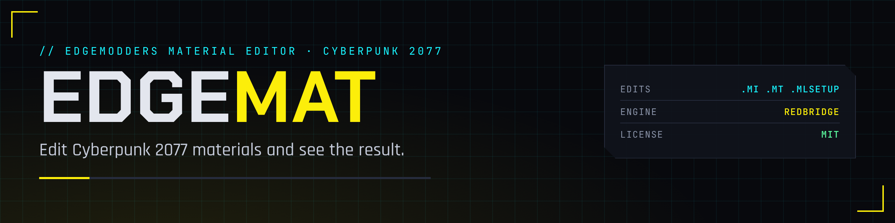

  

  
  
  
  
  

The EDGEmodders material editor for Cyberpunk 2077, a VS Code extension in the EDGE family. Pick a garment, click a layer, choose a color and see it on the model. Or skip the UI: EDGEmat's MCP server lets REDagent or Claude do it when you say "make this jacket red".

It edits multilayered materials (`.mlsetup`, `.mltemplate`, `.mlmask`) first, then material instances and templates (`.mi`, `.mt`). Game files are read and written through [REDbridge](https://github.com/Edgemodders/REDbridge), the same engine [REDcode](https://github.com/Edgemodders/REDcode) uses. The material library is built from your own game, so it is always current.

**[Read the docs](https://edgemodders.github.io/EDGEmat/)** &middot; [Design](docs/design.md) &middot; [Dev setup](docs/dev-setup.md)

> [!NOTE]
> **Status: 0.3.0 preview released** on the [VS Code Marketplace](https://marketplace.visualstudio.com/items?itemName=edgemodders.edgemat) and [Open VSX](https://open-vsx.org/extension/edgemodders/edgemat). A Library of every surface and microblend in your game, built from the game (M1). Surface pages, the setup editor, Find and View in 3D (M2). Editing and Save to Project, and New Material from words or a photo (M3), each seen in the game. Assistants get all of it through MCP. Next: materials for new meshes (M4).

## Repository layout

| Path | Contents |
|---|---|
| `extensions/edgemat` | The VS Code extension. `src/core` is everything that is not UI, with no VS Code imports |
| `packages/edgemat-mcp` | The MCP server, bundling the extension's core |
| `docs/` | Documentation site: the design, the behavior spec, dev setup |
| `tools/brand/` | Renders the banner, icon and badges; `activity.svg` is the activity bar icon |

## Prior art

EDGEmat learns from [MlsetupBuilder](https://github.com/Neurolinked/MlsetupBuilder) by Neurolinked, the multilayered material editor modders know, and from [WolvenKit](https://github.com/WolvenKit/WolvenKit) and the [modding wiki](https://wiki.redmodding.org/). It is a new editor, written from scratch, with none of their code or data. See [the design](docs/design.md#prior-art-and-how-edgemat-uses-it).

## Legal

EDGEmat is MIT. Like REDcode, it talks to REDbridge (GPL-3.0, because it links WolvenKit) only as a separate process and never links it. This repository contains no game files and no data extracted from them. Single-player modding only. EDGEmat is not affiliated with CD Projekt RED.

## License

[MIT](LICENSE)
