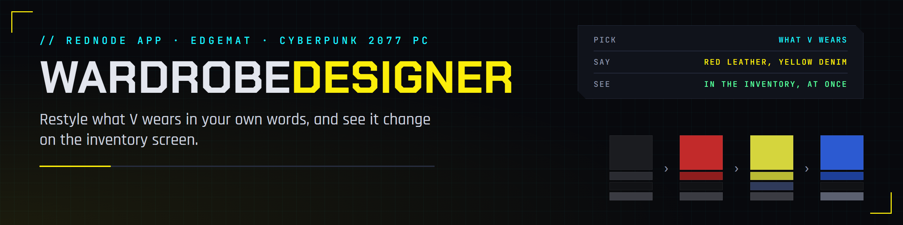

# Wardrobe Designer

**Wardrobe Designer** restyles what V wears in your own words, from the inventory screen. Pick a piece of clothing, type how it should look, such as "red leather" or "yellow denim", and press **Restyle**. REDagent plans the change on the garment's own materials, EDGEmat's core makes them, and REDnode swaps them into the running game. A few seconds later V wears it, in the inventory and in the world.

It is a [REDnode](https://edgemodders.github.io/REDnode/) app for players, built in this repo (`apps/wardrobe-designer`) and released on its own: [Nexus Mods](https://www.nexusmods.com/cyberpunk2077/mods/36636) and this repo's GitHub releases (`wardrobe-designer-v*`). What changed in each version: [its changelog](https://github.com/Edgemodders/EDGEmat/blob/main/apps/wardrobe-designer/changelog.md). How it works inside, and what comes next: [the design](design.html#wardrobe-designer-restyle-what-v-wears-in-the-game-proposed).

**Status:** a preview. Tested in the game on 2026-10-30 (game 2.5, REDnode 0.48.1 and 0.49.1).

## Install

| Needs | Why |
|---|---|
| [REDnode](https://www.nexusmods.com/cyberpunk2077/mods/35419) 0.48.1 or later, with REDswap (installed with it) | Runs the app, and swaps its archive into the game |
| REDbridge, from REDnode's Mod Manager (**Get REDbridge**) | Reads the game's clothing and writes the new materials |
| [REDagent](https://www.nexusmods.com/cyberpunk2077/mods/35670), with your Anthropic key | Plans each restyle |
| Cyberpunk 2077 2.5 | As REDnode |

1. Install the zip with Vortex, or extract it into the game folder: the app lands in `red4ext/plugins/REDnode/apps/wardrobe-designer/`.
2. In the game, press **F10** and open the **Mod Manager** from the launcher (the **REDNODE** tab at the lower left). Select **Wardrobe Designer**, allow its three permissions (**REDbridge**, **REDagent** and swapping **archives** into the game), and switch it on. **Pin to launcher** keeps it one press away.
3. The first time, it reads your game's materials, about half a minute, and again after a game update. The window says so.

## Use

| Do | What happens |
|---|---|
| Open the inventory (**I**), with V in view. Press **F10** until the window takes input | The window shows one button for each slot with what V wears there: **Head**, **Face**, **Outer torso**, **Inner torso**, **Legs**, **Feet**, **Outfit**. A **\*** marks one you restyled |
| Press a slot | The log lists that item's layered materials: each layer's surface, color and share of the garment |
| Type how it should look in **How should it look?**, press **Restyle** | REDagent's plan (a few seconds, one to five US cents), the materials saved, packed and swapped in. V and the inventory's preview show it |
| Restyle it again | It builds on the first: "make it glossier" keeps the red |
| **Restore** | The item goes back to the game's own look |
| **Refresh** | Reads what V wears again, after you change clothes |

What words do:

| Words | Do |
|---|---|
| A color: "red", "dark blue", "pale green", "medium blue" | The closest color the game's surface has |
| A material: "denim", "leather", "cotton" | Every layer of the old material changes to the game's plain version of the new one; trims and dirt stay |
| A finish: "glossy", "matte", "shinier" | The closest finish that surface has; the log says which |
| A pattern: "polka dots", "camo" | Not supported yet: the base color, and a note |

## Good to know

| | |
|---|---|
| Everyone in that look changes | A restyle replaces the item's mesh, so NPCs wearing the same item change too. A V-only version is planned |
| Where restyles live | One archive, `archive\pc\mod\WardrobeDesigner.archive`, so they stay after a restart. The app's work files and its list of restyles are in REDnode's data folder for it (`%APPDATA%\@rednode\overlay\packages\wardrobe-designer`) |
| The AI's cost | REDagent uses your Anthropic key and keeps a daily limit for each app ($0.25 at first). Change it in REDagent: **Chats**, the **Mods** tab, Wardrobe Designer's limit, **Set** |
| Items it cannot change | Items with no layered materials (fixed textures only), and items added by other mods (ArchiveXL), for now |
| Uninstall | **Restore** what you restyled, then remove the app. To drop every restyle at once, delete `archive\pc\mod\WardrobeDesigner.archive` with the game closed |

## For modders and assistants

The same restyle is EDGEmat's MCP tool `mat_restyle`: in Claude Code or EDGEchat, an assistant reads an item's look, plans, and saves the restyle into a WolvenKit project, which REDcode packs. See [EDGEmat's changelog](changelog.html).
