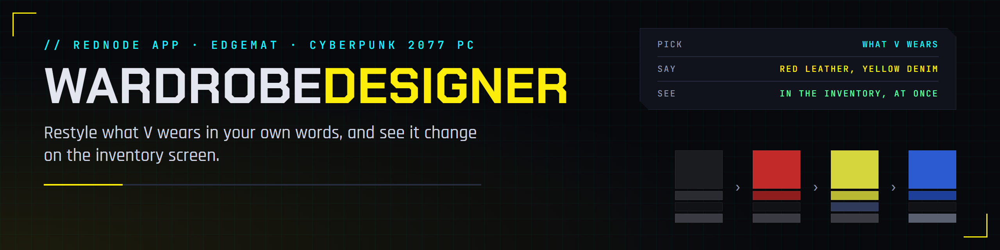

# Wardrobe Designer

**Wardrobe Designer** restyles what V wears in your own words, from the inventory screen. Pick a piece of clothing, type how it should look, such as "red leather" or "yellow denim", and press **Restyle**. REDagent plans the change on the garment's own materials, EDGEmat's core makes them, and REDnode swaps them into the running game. A few seconds later V wears it, in the inventory and in the world.

It is a [REDnode](https://edgemodders.github.io/REDnode/) app for players, built in this repo (`apps/wardrobe-designer`) and released on its own: [Nexus Mods](https://www.nexusmods.com/cyberpunk2077/mods/36636) and this repo's GitHub releases (`wardrobe-designer-v*`). What changed in each version: [its changelog](https://github.com/Edgemodders/EDGEmat/blob/main/apps/wardrobe-designer/changelog.md). How it works inside, and what comes next: [the design](design.html#wardrobe-designer-restyle-what-v-wears-in-the-game-proposed).

**Status:** a preview. Tested in the game on 2026-10-30 (game 2.5, REDnode 0.48.1 and 0.49.1).

## Install

| Needs | Why |
|---|---|
| [REDnode](https://www.nexusmods.com/cyberpunk2077/mods/35419) 0.56.1 or later, with REDswap (installed with it) | Runs the app, and swaps its archive into the game |
| REDbridge, from REDnode's Mod Manager (**Get REDbridge**; it installs .NET 10 if missing) | Reads the game's clothing and writes the new materials |
| [REDagent](https://www.nexusmods.com/cyberpunk2077/mods/35670), with your Anthropic key | Plans each restyle |
| An OpenAI key, for patterns and Reshape; a Tripo key, for Reshape | Your own accounts and credits; the [Keys](#your-keys) panel asks for them |
| Cyberpunk 2077 2.5 | As REDnode |

Not needed: Cyber Engine Tweaks, ArchiveXL, TweakXL, WolvenKit.

1. Install the zip with Vortex, or extract it into the game folder: the app lands in `red4ext/plugins/REDnode/apps/wardrobe-designer/`.
2. In the game, press **F10** and open the **Mod Manager** from the launcher (the **REDNODE** tab at the lower left). Select **Wardrobe Designer**, allow what it asks for (**REDbridge**, **REDagent**, swapping **archives** into the game, and your **OpenAI**, **Tripo** and **Gemini** keys, each used only by the feature that needs it), and switch it on. **Pin to launcher** keeps it one press away.
3. The first time, it reads your game's materials, about half a minute, and again after a game update. The window says so.

## Use

| Do | What happens |
|---|---|
| Open the inventory (**I**), with V in view. Press **F10** until the window takes input | The window shows one button for each piece V visibly wears, named by where it is worn (**Head**, **Outer torso**, **Legs**...). With Equipment-EX, its slots too (**Torso outer**, **Necklace short**, **Hands**...). A **\*** marks one you restyled |
| Press a slot | The log lists that item's layered materials: each layer's surface, color and share of the garment |
| Type how it should look in **How should it look?**, press **Restyle** | REDagent's plan (a few seconds, one to five US cents), the materials saved, packed and swapped in. V and the inventory's preview show it |
| Restyle it again | It builds on the first: "make it glossier" keeps the red |
| **Restore** | The item goes back to the game's own look |
| **Refresh** | Reads what V wears again, after you change clothes |

What words do:

| Words | Do |
|---|---|
| A color: "red", "dark blue", "pale green", "medium blue" | The closest color the game's surface has |
| A material: "denim", "leather", "cotton" | Every layer of the old material changes to the game's plain version of the new one; trims and dirt stay |
| A finish: "glossy", "matte", "shinier" | The closest finish that surface has; the log says which |
| A pattern: "yellow with large black polka dots", "red and black tartan", "woodland camo" | REDagent picks the material and the pattern's size; OpenAI's GPT Image makes it as a texture with your key; it covers that whole material, the garment's folds kept. "Larger dots" or "smaller checks" changes the size, with the same picture and no new cost; plain words afterwards ("red leather") take the pattern off. The first time, REDnode asks for your OpenAI key in its own window (platform.openai.com > API keys). **Patterns: GPT Image** switches to Google Gemini, for a Gemini key instead (aistudio.google.com > Get API key) |

### Reshape: change its shape

A first version. It changes a piece of clothing's shape by words, through pictures you can refine before anything is made.

| Do | What happens |
|---|---|
| Press a slot, then **Reshape** | The item is drawn from four sides (front, left, back, right) in its look as V wears it. The Reshape line says whether it can be made yet |
| Type the change in **Change its shape** ("make the brim twice as wide"), press **Change** | OpenAI's GPT Image changes the pictures with your key (about half a minute, a few tens of US cents). Look at them before going on: the model follows the pictures, mistakes included |
| Change again ("a little narrower") | It builds on the last change |
| **Back** | Takes the last change away |
| **Make it**, then **Make it** again within 10 seconds | Tripo makes the 3D model from the pictures and brings it to the game's size (about 60 of your Tripo credits, about 4 minutes), then it is fitted on V and swapped in, as a restyle is. **Restore** takes it away |

| | |
|---|---|
| What can be made | Clothing that moves with one bone: hats, helmets, glasses. Other clothing can be changed in pictures; making it waits for the fit to bend with the body, which comes next |
| The pictures | Side by side in the window, as it is and changed, on a dark background; a click opens one larger. Each is also kept in the app's data folder, on white (the background the image service and the fit work with) |
| Only this body | A reshape changes the look for V's body; the other body's version and the item's other colors stay as they were, for now |

## Your keys

While a key the app uses is missing, the window opens on **your keys**. Each key shows **Ready** or **Needed**; **Set** opens REDnode's own window, where you type the key (never in Wardrobe Designer), and it is kept for every EDGE tool. When every key is ready, the window goes on to the main view by itself; **Continue without them** goes on anyway, and a feature that needs a missing key says so. **Keys** in the main view comes back to it.

| Key | For | Where to make it |
|---|---|---|
| OpenAI | GPT Image: patterns and Reshape's pictures | platform.openai.com > API keys |
| Tripo | Reshape's 3D models | Tripo's developer console > API Keys |
| Google Gemini | Patterns, only after **Patterns: GPT Image** is switched to Gemini | aistudio.google.com > Get API key |
| Anthropic | REDagent, which plans every restyle | Set in REDagent |

## Good to know

| | |
|---|---|
| Everyone in that look changes | A restyle replaces the item's mesh, so NPCs wearing the same item change too. A V-only version is planned |
| Where restyles live | One archive, `archive\pc\mod\WardrobeDesigner.archive`, so they stay after a restart. The app's work files and its list of restyles are in REDnode's data folder for it (`%APPDATA%\@rednode\overlay\packages\wardrobe-designer`) |
| The AI's cost | REDagent uses your Anthropic key and keeps a daily limit for each app ($0.25 at first). Change it in REDagent: **Chats**, the **Mods** tab, Wardrobe Designer's limit, **Set**. A pattern is one image from GPT Image (or Gemini) on your own key: a few US cents, the service's own prices apply |
| Patterns | A pattern replaces every layer of the material it goes on, trims and wear included, so on a garment with one material the whole garment takes it. A logo or a picture in one place is not supported yet |
| Items it cannot change | Items with no layered materials (fixed textures only), and items added by other mods (ArchiveXL), for now |
| Uninstall | **Restore** what you restyled, then remove the app. To drop every restyle at once, delete `archive\pc\mod\WardrobeDesigner.archive` with the game closed |

## For modders and assistants

The same restyle is EDGEmat's MCP tool `mat_restyle`: in Claude Code or EDGEchat, an assistant reads an item's look, plans, and saves the restyle into a WolvenKit project, which REDcode packs. See [EDGEmat's changelog](changelog.html).
